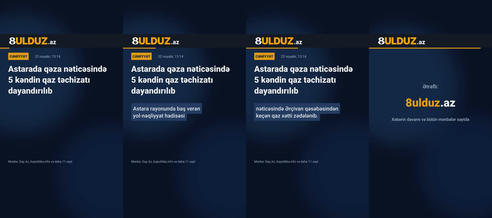

# Video xəbərlər: Facebook və Instagram (Reels)

Sahibin göstərişi (2026-11-22): «Facebook-da video xəbərlər verilsin. Bunun üçün oxu.az və crossmedia.az və digər saytların təcrübəsini incələ, yararlı olanlardan istifadə et. İnstagramda videolar verilsin. Videolarda başda 8ulduz.az yazılsın.»



## Qısa

- Ən vacib xəbərdən (social.cjs-in seçimi: son 3 saatda 4+ mənbə və ya Prezident bölməsi) **öz hazırladığımız** şaquli video düzəlir: brend fonu, yuxarıda başdan sona loqo və «8ulduz.az», böyük başlıq, izah altyazı kimi, istəyə görə Azərbaycan səsi (SARA), sonda «Ətraflı: 8ulduz.az».
- Video Facebook səhifəsinə Reels, Instagram-a Reels kimi gedir. Facebook mətnində saytdakı həmin xəbərin keçidi var, Instagram-da «Ətraflı: 8ulduz.az (keçid profildədir)».
- 2 saatdan bir, Bakı vaxtı ilə 08:00–23:59 arası, gündə ən çox 8 video. Hamısı GitHub Actions-da işləyir, kompüterdən asılı deyil.
- Üçüncü tərəfin videosu, fotosu, musiqisi videoya düşmür (aşağıda «Müəllif hüququ»).

## Araşdırma: Azərbaycan mediası necə edir (2026-11-22)

Facebook, Instagram və TikTok səhifələrinə giriş etmədən baxılıb. Instagram girişsiz baxış sayını göstərmir, ona görə orada populyarlıq bəyənmə ilə ölçülüb. «Göründü» — birbaşa baxılıb, qalanı nəticədir.

| Sayt | Format, uzunluq | Videodakı yazı | Loqo və ünvan | Post mətni, keçid | Tezlik, baxış |
|---|---|---|---|---|---|
| Oxu.az ([IG](https://www.instagram.com/oxuaz/) 296 min, [FB](https://www.facebook.com/oxu.azz/reels/) 222 min) | IG Reels 4:5 (1080×1350), nümunə 75 s; FB-də ən çox baxılan 24 s | Başlıq 3 sətir, ağ qalın şrift, aşağı üçdə birdə, tünd keçidin üstündə; videonun ətrafında nazik çərçivə | Küncdə loqo yoxdur; aşağıda bütün hesabların adı zolaqda (oxu.az, Telegram) | 3–4 cümlə xülasə + 1–2 heşteq, keçid yoxdur; IG bio-da oxu.az. FB mətni xəbərin girişi kimi | IG-də son 12 postun 6-sı Reels, 11-i bir gündə. FB Reels: adətən 1–3 min, ən çox 17 min baxış (futbol hadisəsi) |
| Report.az ([IG](https://www.instagram.com/report.az/) 240 min, [FB](https://www.facebook.com/www.report.az/reels/) 215 min) | 9:16 (1080×1920), hava proqnozu 67 s; FB-də ən çox baxılan 17 s | Sol tərəfdə şaquli rəngli xətt yanında qalın başlıq, açar söz sarı rənglə | Ortada sağda yarımşəffaf «REPORT» | Yalnız başlıq + 4 heşteq; keçid bio-da. FB-də «❗️⚠️» ilə təcili xəbər | IG-də son 12 postun 4-ü Reels. FB: 58–2 400 baxış; ən çoxu öz bürosunun çəkdiyi yanğın |
| APA ([IG](https://www.instagram.com/apaazerbaijan/) 41 min, [FB](https://www.facebook.com/apaxeber/reels/) 99 min) | 9:16, nümunə 10 s; FB-də ən çox baxılan 14 s | Hərəkətli aşağı zolaq, narıncı vurğu | Sağ yuxarı küncdə dairəvi loqo | «⚡️» + başlıq + bir sətir, keçid yoxdur; IG bio Telegram-a aparır | Gündə ~12 post. FB: 410–9 600 baxış (dron hadisəsi) |
| Qafqazinfo ([IG](https://www.instagram.com/qafqazinfo_az/) 650 min) | 4:5, nümunə 39 s | Aşağıda tünd qırmızı zolaqda 2 sətir başlıq | Sol aşağıda kiçik «qafqazinfo.az» | Bir neçə abzas xülasə + mənbə; keçid bio-da | Son 12 postun 6-sı Reels. Ən çox bəyənilən: maraqlı/insan hekayəsi (1 688), idman və məşhurlar (~1 000) |
| Crossmedia.az ([TikTok](https://www.tiktok.com/@crossmedia_azerbaijan) 17 min izləyici) | 9:16 | Aşağıda göy dairəvi qutuda ağ başlıq | Yuxarıda «CROSSMEDIA» | Bio: «Ətraflı Crossmedia.az saytında»; mətndə bəzən xəbərin tam mətni və keçid | Adi videolar 30–216 baxış; ən çox baxılanlar 0,4–1,1 milyon: qəribə/sirli, siyasi şəxs, kamera görüntüsü, şəhər şikayəti, məşhurlar |

Yoxlanmayanlar (vaxt çatmadı və ya giriş tələb etdi): Axar, Modern, Publika, Baku TV, İTV, AZƏRTAC, Milli.az, Caliber; Qafqazinfo və Crossmedia-nın Facebook Reels-i; Oxu, Report, APA və Qafqazinfo-nun TikTok hesabları.

Ümumi müşahidə: hamı başlığı videonun üstünə böyük ağ qalın şriftlə yazır, loqo və ya sayt adı videoda görünür (Reels-də keçid basılmır), post mətnində keçid demək olar ki, yoxdur (bio-da və ya ilk şərhdə). Rəqiblərin çoxu başqasının videosunu (TV, digər hesablar, su nişanı ilə) təkrar yükləyir.

Meta və tədqiqatlardan:

- Facebook Reels API: 9:16, 1080×1920 tövsiyə (ən az 540×960), 24–60 kadr/s, 3–90 s, H.264, AAC 48 kHz; səhifəyə 24 saatda ən çox 30 API Reels ([Meta](https://developers.facebook.com/docs/video-api/guides/reels-publishing)).
- Instagram API: Reels 3 s – 15 dəq, 24 saatda 100 API postu (şəkilli postlarla birlikdə) ([Meta](https://developers.facebook.com/docs/instagram-platform/content-publishing/)).
- Instagram: «ilk 3 saniyə maraqlı olsun»; başqasının su nişanı yayılmanı azaldır; ayda 10+ Reels paylaşan hesablar tez böyüyür ([Instagram Creators](https://creators.instagram.com/faq)).
- Meta-nın «orijinal olmayan məzmun» qaydası (14 iyul 2025): başqasının məzmununu təkrar-təkrar yükləyən səhifələrin bütün postlarının yayılması azalır, pul qazanma bağlanır; öz montajı, səs, şərh «əhəmiyyətli əlavə» sayılır; ən yaxşı mətn keçidsiz, ən çox 5 heşteqlidir ([Meta](https://creators.facebook.com/blog/combating-unoriginal-content)). Instagram 2026-cı ilin aprelində eyni qaydanı bütün post növlərinə yayıb ([PetaPixel](https://petapixel.com/2026/04/30/new-instagram-policies-target-reposted-content/)).
- Tamaşaçıların 69%-i ictimai yerdə videoya səssiz baxır, 80%-i altyazı olanda videonu sona qədər izləməyə daha meyillidir ([Verizon Media/Publicis, 2019](https://www.3playmedia.com/blog/verizon-media-and-publicis-media-find-viewers-want-captions/)).
- Sosial şəbəkədə həftəlik video xəbər istifadəsi 2020-də 52%, 2025-də 65% olub ([Reuters İnstitutu, 2025](https://reutersinstitute.politics.ox.ac.uk/digital-news-report/2025/dnr-executive-summary); Azərbaycan hesabatda yoxdur).

## Seçimlərimiz

| Nə | Nə etdik | Niyə |
|---|---|---|
| Format | 1080×1920, 9:16, 30 kadr/s, 15–35 s (ən çox 59 s) | Hər üç şəbəkənin tövsiyəsi; ən çox baxılan xəbər Reels-ləri 14–24 s idi |
| İlk saniyə | Başlıq 0,12 s-də görünür, səs 0,35 s-də başlıqla başlayır | «İlk 3 saniyə»; lentdə səssiz avtomatik oynayanda da xəbər oxunur |
| Yazı | Böyük ağ qalın başlıq (Roboto Black), altında izah cümlə-cümlə altyazı (göy qutuda), səslə eyni anda | Rəqiblərin hamısı belə edir; səssiz izləyənlər çoxdur |
| Brend | Yuxarıda zolaq: saytın loqosu (8ULDUZ) + «.az» — başdan sona, videoya yandırılıb; gediş xətti narıncı; sonda böyük «8ulduz.az» | Sahibin göstərişi; Reels-də keçid basılmır — ünvan videoda yazılmalıdır |
| Yer | Bütün yazılar y 300…1480 arasında | Lentdə Reels ortadan 4:5-ə kəsilir (Oxu, Qafqazinfo 4:5 yükləyir), tam ekranda yuxarıda və aşağıda şəbəkənin düymələri var |
| Rəng | Saytın tünd göyü və loqonun narıncısı | Brend tanınsın |
| Mənbə | Videoda «Mənbə: Day.Az, Azpolitika.info və daha 11 sayt» | Aqreqatoruq: mənbəni göstərmək həm dürüstdür, həm də başqasının xəbərini öz adımıza çıxarmırıq |
| Səs | SARA (sahibin «Dinlə» üçün seçdiyi açıq model), pulsuz, GitHub-da | Səs «əhəmiyyətli əlavə»dir (Meta), səslə izləyən də anlayır |
| Facebook mətni | Başlıq, izah (≤900 simvol), «Ətraflı: https://www.8ulduz.az/<nömrə>?h=<saat>», 3 heşteq; eyni keçid ilk şərhdə də | Sahibin göstərişi (keçid basılan olsun). Meta keçidsiz mətni üstün tutur — ona görə keçid ilk şərhdə də var; yayılma zəif olarsa mətndəki keçidi götürmək bir sətirlik dəyişiklikdir |
| Instagram mətni | Başlıq, izah, «Ətraflı: 8ulduz.az (keçid profildədir)», 4 heşteq | Instagram keçidi basılan etmir; profildəki keçid 8ulduz.az/ig/ səhifəsinə aparır |
| Tezlik | 2 saatdan bir, 08–23 Bakı vaxtı, gündə ≤8 | Rəqiblər gündə ~6 Reels; Facebook API həddi 30; Instagram həddi 100 (şəkilli postlar gündə ≤80, həddi kod hər videodan əvvəl yoxlayır) |
| Mövzu | social.cjs seçimi: ən çox mənbəli xəbər, Prezident bölməsi; eyni mövzu 24 saatda bir dəfə | Ən çox yazılan xəbər ən maraqlısıdır; qəza, hava, qiymət, idman da 4+ mənbə ilə bura düşür |

Götürmədiklərimiz: başqasının kadrları (aşağıda), musiqi (Meta-nın lisenziyalı musiqisi API ilə əlçatan deyil, başqa musiqi müəllif hüququ riskidir), «❗️⚡️» kimi təcili işarələr (hər xəbərdə olsa mənasını itirir; istəsəniz Prezident və ya 10+ mənbəli xəbərə əlavə etmək olar).

## Görüntü və uzun mətn (sahib, 2026-11-22)

Sahibin sözü: «Videolar tam olaraq biabırçılıqdır. Belə video olmaz. Xəbər uzun olsun biraz və videogörüntü olsun o xəbərə uyğun.»
Əvvəlki video tünd fonda başlıq və bir cümlə idi (~15 s). İndi (`.github/scripts/video-ssenari.cjs`):

- **Mətn:** Gemini (`GEMINI_API_KEY`) mənbə səhifəsinin mətnindən 5–7 cümləlik (ən az 4) diktor mətni yazır (450–700 simvol, ~35–45 s; sahib: «4-7 cümlədə olsun. uzun da olsun»).
  Yoxlama: hər rəqəm mənbədə olmalıdır, kiril, keçid, nida, «bu gün/dünən/sabah», inisial yoxdur, saytın qaydasından keçir. Keçməsə başqa xəbər seçilir.
  **Gemini-siz video yoxdur:** Gemini cavab vermirsə (pulsuz səviyyənin gündəlik limiti), bu dövrədə video hazırlanmır, növbəti dövrədə yenidən
  sınanır — mənbənin öz cümlələri və ümumi kadrla video (2026-11-22 ikinci nümunə) paylaşılmır. Yalnız əl ilə seçilən xəbərdə (`VIDEO_XEBER`) köhnə qayda qalır.
  Model sırası: ən yeni 3 flash, sonra 2 flash-lite (X yazıcısı lite işlətmir, onun limiti video üçün qalır); gündəlik limit 429-u gələn model təkrar soruşulmur.
- **Görüntü:** Gemini 4–6 ingiliscə axtarış ifadəsi də verir; [Pixabay](https://pixabay.com/api/docs/) (`PIXABAY_API_KEY`) və ya
  [Pexels](https://www.pexels.com/api/) (`PEXELS_API_KEY`; 2026-11-22-də Pexels yeni açar vermirdi) video bankından 4–5 klip yüklənir — əvvəl şaquli (ekranı doldurur), yoxdursa üfüqi: tam enində ortada, arxada bulanıq nüsxəsi (9:16-ya kəsilmir: 2026-11-22 nümunəsində kəsilmiş 1080p klip bulanıq çıxdı, sarayın yerinə göy qaldı).
  Klipin təsviri (Pixabay etiketləri, səhifə ünvanı) axtarış sözləri ilə tutuşdurulur: ifadənin əsas sözü (sonuncu konkret söz: «border wall»-da
  «wall», «united states capitol»-da «capitol») klipdə olmalıdır və konkret sözlərin ən az 2-si üst-üstə düşməlidir, yoxsa klip götürülmür
  (2026-11-22 nümunələri: «sərhəd divarı» axtarışına «Mexico City» etiketli dələ, «Kapitoli»yə Yaponiya qalası və Empire State gəlmişdi).
  Əvvəl Gemini-nin ifadələri, klip çatmırsa bölmənin ümumi səhnələri. Hər iki lisenziya pulsuzdur, kommersiya istifadəsinə və
  dəyişdirməyə icazə verir, mənbəni göstərməyi xahiş edir: videoda və post mətnində «Görüntü: Pixabay» (və ya Pexels). Lisenziyalar tanınan insanı pis işıqda göstərməyi
  qadağan edir: mənfi xəbərdə (cinayət, qəza, ölüm) ifadələr insansız səhnələrdir. Açar yoxdursa və ya klip tapılmasa fon tünd göy qalır.
- **Hansı xəbər:** protokol xəbərindən (görüş, qəbul, telefon danışığı, təbrik, başsağlığı; Prezident bölməsi) video hazırlanmır — ümumi kadr
  (yad əl sıxma, yad saray) həmin adamları göstərirmiş kimi görünər. Gemini də hər xəbəri yoxlayır («uygun»: false — növbəti xəbər).
  Axtarış ifadəsində insanların xəbərdəki hərəkəti (görüş, imza, çıxış) və adsız bayraqlar yoxdur; inisiallar («Cey. Di.») tam yazılır.
- **Dizayn:** görüntü bütün ekranı tutur; yuxarıda brend zolağı, altında yarımşəffaf tünd zolaqda bölmə və başlıq, aşağıda altyazılar
  (səslə eyni anda), altda mənbə və «Görüntü: Pixabay», sonda tündləşən ekranda «Ətraflı: 8ulduz.az».

### Montaj, altyazı və etiketlər (sahib, 2026-11-23: «tam professional kimi işlə»)

- **Montaj** (`video-xeber.cjs` `shotPlan`): kəsim danışığın sərhədindədir. Başlıq oxunanda bir kadr gedir, sonra hər altyazı hissəsi bir kadrdır. Kadr 2,6–6,5 s-dir: qısa hissə qonşusuna birləşir, uzunu bölünür. Əvvəl 45 s-lik videoda 5 kadr (~9 s) idi.
  Kliplər montaj planının sırası ilə gedir. Klip təkrarlananda onun işlənməmiş yerindən götürülür (`-ss`).
- **Görüntü sırası** (`video-ssenari.cjs` `goruntu`): Gemini 6–8 sadə ifadə verir: əvvəl əsas səhnə, sonra hər cümləyə bir səhnə, cümlələrin sırası ilə. 8 klip yüklənir, sonra eyni ifadələrin ikinci klipləri.
  Tapılmayan ifadənin yerinə ümumi səhnə qoyulmur, çünki yanlış yerin kadrı uyğun klipin təkrarından pisdir. Bölmənin ümumi səhnələri (yer adı yoxdur) yalnız uyğun klip 3-dən az olanda işlənir.
  Son 3 günün videolarında işlənmiş kliplər götürülmür (`.sosial-video/state.json` → `klip`).
- **Əsl yer** (sahib, 2026-11-23: «həqiqi Gəncənin yeni stadionu olan videolardan istifadə etmək lazımdır. digərləri də belə»): Gemini xəbərin konkret yerlərini verir (`yer`: «Ganja City Stadium», «Ganja», «Azerbaijan»).
  Axtarış əvvəlcə bu yerlərlə aparılır. Şəhər həmişə ölkə ilə axtarılır («ganja azerbaijan»: «ganja» ingiliscədə həm də kənafdır). Tapılan əsl yer görüntüsü başlıq kadrına düşür.
  Etiketində xəbərə aid olmayan ölkə və ya şəhər olan klip götürülmür (`yadYer`; nümunədə Gəncə xəbərinə Batumi stadionu, Gürcüstan xəbərinə Bakı düşmüşdü). Xəbərdə yalnız ölkə varsa, onun paytaxtı da olar.
  **Montaj redaktoru** (`redaktor`). Hər ifadədən 3 namizəd toplanır. Gemini xəbəri, yeri və hər namizədin etiketlərini oxuyub ən çox 8 klipi montaj sırası ilə seçir.
  Söz uyğunluğu bunları buraxırdı: siyahıda olmayan yad şəhəri («lech poznan») və mənası başqa klipi («empty stadium seats» axtarışına köhnə divan). Yalnız seçilən klip yüklənir. Gemini cavab verməsə, ifadə sırası işləyir.
  Redaktor hər namizədin bir kadrını da görür (bankın önizləmə şəkli) və əvvəlcə hər klipin yerini adlandırır (`yerler`: yer, xəbərin yeridirmi). Lövhə və yazının dili, brend, bayraq, nömrə nişanı, hərəkət tərəfi də sayılır.
  Xəbərin yeri olmayan yer görünən klip redaktor seçsə də kodla atılır (`yerUygun`). İlk canlı videoda (2026-11-23, Bakının tıxacları) etiketində «kettering» (İngiltərə) olan dairəvi yol seçilmişdi; Petrobras məntəqəli (Braziliya) və Asiya yazılı şose kliplərinin etiketində yer yox idi. Şəkilli sorğu alınmasa redaktor yalnız etiketlərlə işləyir.
  **Keyfiyyət həddi:** 2-dən az uyğun klip tapılan xəbər ötürülür, növbəti xəbər götürülür (`KLIP_MIN`).
  Qanuni hədd:
  - oyunların və tədbirlərin öz kadrları telekanalların və təşkilatçıların hüququdur;
  - president.az «müəllif hüquqları qorunur» yazır (2026-11-23), Commons-dakı köhnə «CC BY 4.0» qeydinə güvənilmir;
  - əsl yer görüntüsü yalnız sərbəst lisenziya ilə yayılıbsa (Pixabay, Pexels) götürülür.
- **Altyazı:** deyilən söz narıncı yanır, sonra yenə ağ olur. Söz vaxtı səs modelinin hissə vaxtından bölünür (`wordTimes`): hərf sayı, rəqəm (sözlə oxunur), qısaltma (hərf-hərf) və durğu fasiləsi nəzərə alınır.
- **Etiketlər:** Gemini 3 mövzu etiketi verir. Etiketdən «#», boşluq və kiril atılır, ümumi etiketin təkrarı da atılır. Etiketlər Facebook, Instagram, YouTube (`video.json` `hashtags`) və TikTok mətnlərinə gedir, ümumilərdən (`#8ulduz #xəbərlər #Azərbaycan`) əvvəl.
- **Yoxlama:** PR-da süni kliplərlə (şaquli və üfüqi) görüntülü video hazırlanır; əl ilə önizləmə (`paylas` söndürülüb) istənilən budaqda işləyir.

## Müəllif hüququ (sərt qayda)

Videoya yalnız hüququmuz olan şey düşür: xəbərin başlığı və izahı (mənbə göstərilir), saytın dizaynı və loqosu, SARA səsi və Pexels-in
pulsuz lisenziyalı klipləri (yuxarıda). Kod bunu testlə qoruyur (`tests/sosial-video.test.cjs`: video modulu xəbərin şəklini və videosunu, `reels.json`/`oz_x.json` videolarını işlətmir; ffmpeg-in girişləri yalnız rəngli fon, loqo və səsdir).

Tətbiq edilməyən variantlar — **qərar sahibindir**:

| Variant | Fayda | Risk |
|---|---|---|
| X-dəki videolar (F1, NBA, Fox News, klublar; `data/reels.json`, `oz_x.json`) öz səhifəmizə yüklənsin | Hazır, hərəkətli, maraqlı görüntü | Meta Rights Manager avtomatik tutur: video silinir, səhifəyə «xəbərdarlıq», təkrar olanda səhifənin yayılması kəsilir və ya səhifə bağlanır. Meta-nın 2025 qaydası ilə «orijinal olmayan» səhifə sayılırıq — **bütün** postların yayılması azalır |
| Mənbə saytların videoları və TV kadrları (rəqiblərin çoxu belə edir, su nişanı ilə) | Rəqiblərin ən çox baxılan Reels-ləri belədir | Eyni Rights Manager riski, üstəlik mənbə saytla münasibət; su nişanlı video Instagram-da yayılmır |
| Xəbərin fotosu (mənbənin şəkli) videoda fon kimi | Video daha canlı görünür, lentdə şəkil diqqət çəkir | Foto da müəllif əsəridir; Rights Manager şəkilləri də tutur. Instagram-dakı şəkilli postlarımız artıq mənbənin şəklini işlədir (sahibin əvvəlki qərarı) — videoya da əlavə etmək asandır (bir dəyişən), amma riski artırır |
| Rəsmi mənbələrin (president.az, AZƏRTAC) foto və videoları | Prezident xəbərlərində rəsmi görüntü | Saytların istifadə şərtləri ayrıca yoxlanmalıdır (adətən istinadla icazə); yalnız açıq icazə olanda |

## Video modulu: `.github/scripts/video-xeber.cjs`

TikTok paylaşımı da eyni modulun hazırladığı faylı yükləyir (PR [8ulduz/8ulduz#293](https://github.com/8ulduz/8ulduz/pull/293), `docs/tiktok.md` §7). Qoşulma: `sosial-video.yml`-in `tiktok` işi `tiktok.yml`-i çağırır (`artifact: video-xeber`, yalnız TikTok sirləri). Bu iş yalnız `main`-də, əsl paylaşım dövrəsində (`paylas == '1'`) və video yoxlamadan keçəndə (`yoxlandi == '1'`) işləyir. Seçim (`VIDEO_ACAR`) Facebook, TikTok və ya YouTube açarı olanda işləyir. YouTube Shorts da eyni faylı yükləyir: `youtube` işi eyni şərtlərlə `youtube.yml`-i çağırır (`artifact: video-xeber`, yalnız YouTube sirləri, [youtube.md](youtube.md)). «8ulduz.az» zolağı yuxarıdan 15,6%-dədir (TikTok-un üst yazıları ~8–10%-i örtür).

İşlədilmə:

```
node .github/scripts/video-xeber.cjs <giriş.json> <çıxış.mp4>
```

və ya Node-dan: `const { render } = require("./video-xeber.cjs"); await render(sətir, "video.mp4")`.

**Giriş** — `data/news.json` sətri:

| Sahə | Nə üçün |
|---|---|
| `id`, `title` | başlıq (məcburi) |
| `text` | ekranda və səsdə izah: social.cjs `describe()` nəticəsi (mənbə səhifəsinin tam cümlələri); yoxdursa `summary`-nin tam cümlələri. Ən çox 360 simvol (≈3 cümlə) |
| `category` və ya `bolme` | yuxarıdakı bölmə nişanı (saytın `CATS` adları, böyük hərflə) |
| `source`, `alts[].source` | «Mənbə: A, B və daha N sayt» |
| `publishedAt` | Bakı vaxtı ilə tarix və saat |
| `ses: false` | səssiz (və ya mühitdə `VIDEO_SES=0`) |

Xəbər saytın qaydasından (`policyViolation`, qırmızı xətt 2) keçməsə video olmur (xəta). İzah da ayrıca yoxlanır.

**Çıxış:**

| Fayl | Nə |
|---|---|
| `<çıxış>.mp4` | MP4, moov əvvəldə (`+faststart`); H.264 High 4.1, yuv420p, BT.709, 1080×1920, 30 kadr/s, GOP 2 s (qapalı), CRF 21, ≤8 Mbit/s; AAC-LC 48 kHz stereo 128 kbit/s, səs −16 LUFS; 8–59 s (adətən 20–30 s, ~1,5 MB). Faylda nişan `comment=8ulduz.az` — TikTok yükləyicisi yalnız bu nişanlı (öz) videonu göndərir |
| `<çıxış>.json` | xəbərin sahələri `{ id, own: true, title, summary, text, source, sourceUrl, category, lang, publishedAt }` + texniki `{ duration, bytes, width, height, vcodec, pix, fps, acodec, rate, channels, cover_s, kadrlar, voice, parts }` (kadrlar: önizləmə üçün anlar, saniyə). TikTok yükləyicisi bu faylı oxuyur: `text` — mətn, `cover_s` — üz qabığı |
| `<çıxış>.jpg` | örtük kadrı (`cover_s` = 1,5 s, başlıq tam görünür) |

**Ekran planı (1080×1920):** y 300–420 brend zolağı (loqo + «.az», başdan sona), y 420 narıncı gediş xətti, y ~466 bölmə nişanı və vaxt, y 556-dan başlıq (96→60 px, ən çox 470 px hündürlük), altında altyazı (62 px, ən çox 3 sətir, göy qutuda), y 1404 mənbə, sonda 2,8 s «Ətraflı: 8ulduz.az». Fon: tünd göy, iki yumşaq hərəkətli işıq.

**Zaman:** səs varsa hər hissənin vaxtı səsdən (`video_ses.py`), yoxsa oxuma sürətindən (~13 simvol/s, hər altyazı ≥2,4 s). 59 s-ni keçərsə sondakı altyazılar düşür.

**Lazımdır:** ffmpeg (libass ilə) və Roboto şrifti — ubuntu-latest-də `sudo apt-get install -y ffmpeg fonts-roboto-unhinted`. Səs üçün Python + `torch` (CPU) + `transformers` (`.github/scripts/video_ses.py`, model `BHOSAI/SARA_TTS`, mətn «Dinlə» serverinin `az_text.py` qaydası ilə). Səs alınmasa video səssiz hazırlanır, iş dayanmır.

## Paylaşım: `.github/workflows/sosial-video.yml` + `.github/scripts/sosial-video.cjs`

1. Hər 30 dəqiqədən bir (:17, :47) iş başlayır. Vaxtı deyilsə (gecə, fasilə, gündəlik hədd) ~20 saniyədə bitir: ffmpeg və model quraşdırılmır.
   İşi xəbər axını başladır (`pipeline.sh` `video_loop`, yalnız dispatch; main-də video işi gedirsə və ya bu pəncərədə artıq başlayıbsa yox): iş axınının cron-u 2026-11-22-də
   bir dəfə də işləmədi (X yazıcısında da belə olmuşdu). Cron ehtiyat qalır. Xəbər axını hər saat yenidən başlayır: pəncərə yoxlanmasa, 04:17 pəncərəsində 04:36-da ikinci iş gedirdi (2026-11-23).
2. **Seçim** (`sosial-video.cjs sec`): lent saytın qaydasından keçir; social.cjs-in namizədləri; əvvəl video olmuş xəbər, başlıq və mövzu (24 saat) ötürülür; mənbə səhifəsindən izah tapılmayan xəbər video olmur.
3. **Video** (`video-xeber.cjs`), sonra yoxlama: ölçü, kodek, kadr sürəti, səs, müddət, moov əvvəldə. Uyğun deyilsə iş qırmızıdır, heç nə paylaşılmır.
4. **Paylaşma** (`sosial-video.cjs paylas`): fayl hər iki şəbəkəyə **birbaşa** yüklənir (Meta-nın `rupload.facebook.com` serverinə, «resumable upload»). İctimai ünvan və saxlama yeri lazım deyil, repoya video yazılmır (repo ölçüsü, `repo-olcu.yml`). Video yalnız iş səhifəsində 3 günlük artefakt kimi qalır.
   - Facebook: `POST /{səhifə}/video_reels` (start) → fayl → `finish` (`video_state=PUBLISHED`, `description` keçidlə) → emal bitəndə ilk şərh «Ətraflı: keçid».
   - Instagram: `POST /{ig}/media` (`media_type=REELS`, `upload_type=resumable`, `caption`, `thumb_offset=1500`) → fayl → status `FINISHED` (15 s-dən bir, ən çox 5 dəq) → `media_publish`. Əvvəl 24 saatlıq hədd (`content_publishing_limit`) yoxlanır. Yükləmə alınmasa (2026-11-22, 16,8 MB: `ProcessingFailedError`, «retriable: false») 1 dəqiqə sonra yeni konteynerlə bir dəfə təkrar olunur.
5. Siyahı (`.sosial-video/state.json`, actions/cache) 3 gün saxlanır: eyni xəbər iki dəfə getmir.

Bu iş xəbər axınından (`update.yml`) və şəkilli paylaşmadan (`social.yml`) ayrıdır: düşsə də, gecikse də onlara təsir etmir; sayta heç nə yazmır (qırmızı xətt 1 və 3).

PR-da (`pull_request`) nümunə xəbərdən (`tests/fixtures/video-xeber.json`) video hazırlanır və yoxlanır, paylaşılmır; kadrlar və video artefaktdadır.

## Sahibin əlavə etməli olduğu icazələr

Açar `FB_PAGE_TOKEN` artıq var (social.yml ilə eyni sirr). Açar yoxdursa iş heç nə hazırlamadan ötürülür.

1. **Facebook Reels — yeni icazə lazım deyil.** Lazım olanlar: `pages_show_list`, `pages_read_engagement`, `pages_manage_posts` — bunlar sosial-paylasma.md-dəki açarda var. (`publish_video` lazım deyil: o, canlı yayım üçündür.)
2. **Facebook ilk şərh (istəyə bağlı): `pages_manage_engagement` və `pages_read_user_content`.** Olmasa video yenə gedir, keçid yalnız post mətnində olur, jurnalda «keçidli şərh yazılmadı» yazılır. 2026-11-23-də Meta videoya şərhi «(#200) The permission(s) pages_read_user_content,pages_manage_engagement are not available» ilə qaytardı: hər ikisi lazımdır. Səhifədə hüquq: MODERATE ([Meta, şərhlər](https://developers.facebook.com/docs/pages-api/comments-mentions)).
3. **Instagram Reels:** `instagram_basic`, `instagram_content_publish` (artıq var). Faylın birbaşa yüklənməsi Meta-nın sənədinə görə yalnız **Facebook Login for Business** işlədən tətbiqlər üçündür. «8ulduz paylasma» tətbiqi «Business» növündədir, onda bu standartdır; ilk Instagram videosunda jurnalda «konteyner: …» xətası çıxsa, developers.facebook.com → «8ulduz paylasma» → Products-da «Facebook Login for Business» olduğunu yoxlayın.
4. **Baxış statistikası (tövsiyə olunur):** `read_insights`, `instagram_manage_insights`. Olmasa «Meta açarı və görünmə» işi baxışı ölçə bilmir və Facebook paylaşımlarının görünüb-görünmədiyini yoxlaya bilmir. 2026-11-23-də açarda ikisi də yox idi (Meta: «(#200) read_insights permission missing»).

### Meta açarı: yoxlama və yeniləmə

**Yoxlama.** Actions → «Meta açarı və görünmə» (`meta-yoxla.yml`) → Run workflow. İş həftədə bir dəfə, bazar ertəsi 09:23-də özü də işləyir. Heç nə paylaşmır. Xülasədə bunlar var: açarın növü, müddəti, məlumat girişinin bitmə tarixi, icazələr, səhifədəki hüquqlar, son 10 Facebook və Instagram videosunun baxışı, əhatəsi və bəyənməsi. Paylaşım icazəsi yoxdursa, açarın müddəti bitibsə və ya Facebook videolarını heç kim görmürsə, iş qırmızı olur. Keçidli şərh icazəsi yoxdursa, yalnız xəbərdarlıq verir.

**Tətbiqin rejimi (Development / Live).** Meta yazır: «Any data generated while an app is in Development mode, such as test posts, can only be seen by role users» ([App modes](https://developers.facebook.com/docs/development/build-and-test/app-modes/)). «8ulduz paylasma» Development rejimində qalsa, Facebook paylaşımlarını yalnız tətbiqin rol sahibləri görür. Yoxlama bunu belə tutur: 6 saatdan köhnə Facebook videolarının hamısını ən çox 2 nəfər görübsə (`META_ROLE_MAX`), iş qırmızı olur. Düzəliş:

1. developers.facebook.com → My Apps → «8ulduz paylasma» → App settings → Basic. Burada **Privacy Policy URL** `https://www.8ulduz.az/mexfilik/`, **Terms of Service URL** `https://www.8ulduz.az/sertler/` və **User data deletion** (məlumatların silinməsi qaydası: `https://www.8ulduz.az/mexfilik/`), kateqoriya və ikon doldurulur → Save.
2. Səhifənin yuxarısında **App Mode: Development** → **Live**. Yeni paneldə bu, **Publish** düyməsidir.
3. Actions → «Meta açarı və görünmə» → Run workflow. İcazələr yerindədirsə, növbəti Facebook videolarının baxışı artmalıdır.

**Keçidli şərh üçün açarı yeniləmək** (yuxarıdakı 2-ci bənd):

1. developers.facebook.com → My Apps → «8ulduz paylasma» → **Use cases** → «Manage everything on your Page» → **Customize** → Permissions. `pages_manage_engagement`, `pages_read_user_content` və `read_insights` yanında **Add** düyməsini basın. Meta yazır: «Click Add next to each additional features or permissions that your app needs» ([Meta, tətbiq qurulumu](https://developers.facebook.com/docs/pages-api/create-an-app)). Instagram ssenarisində də `instagram_manage_insights` əlavə edin.
2. Tools → **Graph API Explorer** → Meta App: «8ulduz paylasma» → User or Page: **Get User Access Token**. Bu icazələri seçin: `pages_show_list`, `pages_read_engagement`, `pages_manage_posts`, `pages_manage_engagement`, `pages_read_user_content`, `instagram_basic`, `instagram_content_publish`, `read_insights`, `instagram_manage_insights`. Sonra **Generate Access Token** basın. Açılan Facebook pəncərəsində «8ulduz» səhifəsini və Instagram hesabını seçib icazə verin.
3. Tools → **Access Token Debugger** → açarı yapışdırın → **Debug** → aşağıda **Extend Access Token**. Uzunmüddətli açarı kopyalayın.
4. GitHub → 8ulduz/8ulduz → Settings → Secrets and variables → Actions → `FB_PAGE_TOKEN` → **Update secret** → açarı özünüz yapışdırın. Eyni açar şəkilli paylaşmada da işləyir. Açarı heç kimə göndərməyin.
5. Actions → «Meta açarı və görünmə» → Run workflow. «Keçidli şərh üçün icazə yoxdur» xəbərdarlığı itməlidir. Növbəti videonun jurnalında «keçidli şərh yazılmadı» olmamalıdır.

İlk yoxlama: Actions → «Video xəbər (Facebook, Instagram)» → Run workflow → «Paylaş» işarəsini götürün → iş bitəndə Artifacts-da `video-xeber` (video və kadrlar). Bəyənsəniz heç nə etmək lazım deyil — iş 08:00-dan özü paylaşır.

## Tənzimləmə (Variables, istəyə bağlı)

| Dəyişən | Standart | Nə |
|---|---|---|
| `VIDEO_MIN_GAP_MIN` | 120 | iki video arasında dəqiqə |
| `VIDEO_SAAT` | 8-23 | Bakı vaxtı ilə hansı saatlarda (daxil) |
| `VIDEO_GUNDE` | 8 | 24 saatda ən çox video (Facebook həddi 30) |
| `VIDEO_MIN_SOURCES` | `SOCIAL_MIN_SOURCES` və ya 4 | neçə mənbə yazanda |
| `VIDEO_SES` | (açıq) | `0` — səssiz video (model quraşdırılmır) |
| `VIDEO_FACEBOOK`, `VIDEO_INSTAGRAM` | (açıq) | `0` — həmin şəbəkəyə video getmir. `INSTAGRAM=0` Instagram-ı hər iki işdə söndürür |
| `VIDEO_FB_SERH` | (açıq) | `0` — Facebook-da keçidli ilk şərh yazılmır |

Əl ilə: Run workflow → «Xəbər nömrəsi» (16 simvol) — həmin xəbərin videosu fasiləni gözləmədən hazırlanır.

## Yoxlama

GitHub → Actions → «Video xəbər (Facebook, Instagram)» → son iş. Jurnalda: «video: seçildi — …», «video: 1080×1920, 24.3 s, 1.6 MB, 4 altyazı, səsli — …», hər şəbəkə üçün «video paylaşıldı» və ya «video alınmadı — səbəb». Açar heç vaxt jurnala düşmür. İşin xülasəsində videonun başlığı və ölçüsü, Artifacts-da video və kadrlar.

## Qərar gözləyən məsələlər

- Üçüncü tərəf görüntüsü (yuxarıdakı cədvəl) — indi heç biri tətbiq edilmir.
- Tezlik: 8/gün başlanğıcdır; bir həftədən sonra baxış sayına görə artırmaq (Facebook həddi 30) və ya saatları dəyişmək olar.
- Facebook mətnində keçid: sahibin göstərişi ilə qoyulub; Meta keçidsiz mətni üstün tutduğuna görə yayılma zəif olarsa keçidi yalnız ilk şərhdə saxlamaq olar.
